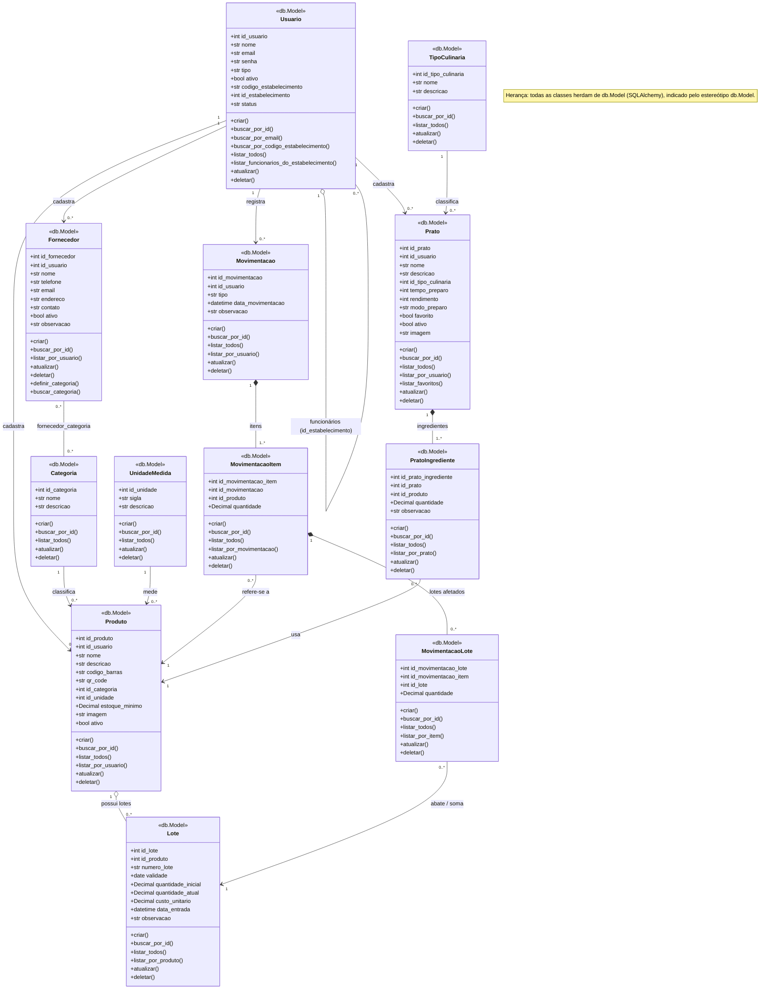

# Diagrama de Classes do Domínio

Diagrama das classes implementadas em `backend/models/` e seus relacionamentos.
Ele é coerente com as Models do backend e com o banco (`backend/database/estrutura do banco/create_database.sql`).

Arquivos desta pasta:

- `diagrama_de_classes.png` — imagem pronta para visualização;
- `diagrama_de_classes.svg` — versão vetorial;
- `diagrama_de_classes.mmd` — código-fonte em Mermaid (o bloco abaixo é o mesmo, e o GitHub o renderiza automaticamente).

## Como ler o diagrama

| Conceito | Onde aparece |
|---|---|
| **Herança** | Todas as 12 Models herdam de `db.Model` (SQLAlchemy). Está indicado pelo estereótipo `«db.Model»` em cada classe. |
| **Composição** (◆) | `Movimentacao` → `MovimentacaoItem` → `MovimentacaoLote`, e `Prato` → `PratoIngrediente`. A parte não faz sentido sem o todo. |
| **Agregação** (◇) | `Usuario` (Administrador) → `Usuario` (Funcionários, auto-relacionamento por `id_estabelecimento`) e `Produto` → `Lote`. |
| **Associação** (→) | Chaves estrangeiras entre as demais classes (ex.: `Categoria` → `Produto`, `TipoCulinaria` → `Prato`). |
| **Muitos-para-muitos** | `Fornecedor` ↔ `Categoria`, pela tabela associativa `fornecedor_categoria` (sem Model própria; o acesso fica em `Fornecedor.definir_categoria()` e `Fornecedor.buscar_categoria()`). |

Observações:

- O diagrama representa apenas o **domínio** (Models). Controllers, Services e Repositories não entram aqui.
- Os métodos listados são os de persistência de cada Model (`criar`, `buscar_por_id`, `listar_todos`, `atualizar`, `deletar` e consultas específicas).
- `Usuario`, `Produto`, `Prato` e `Fornecedor` fazem *soft delete* (campo `ativo`).

## Código-fonte (Mermaid)

